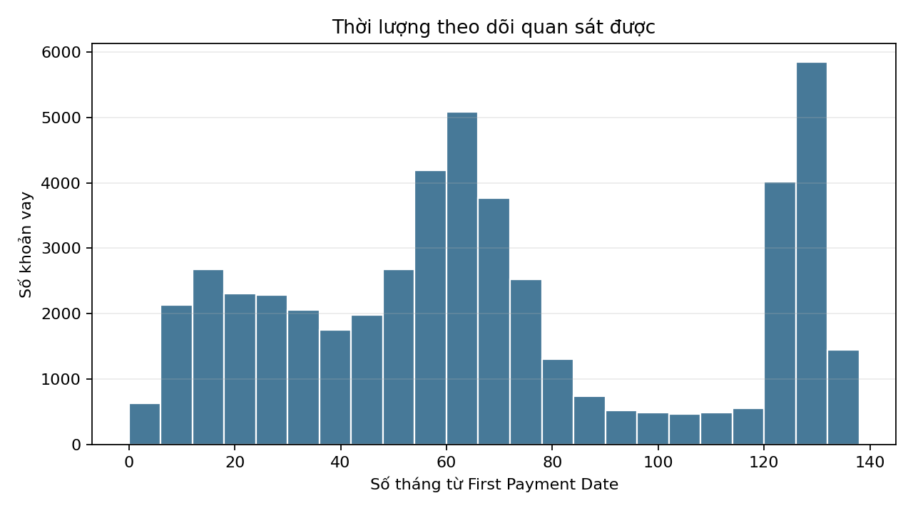
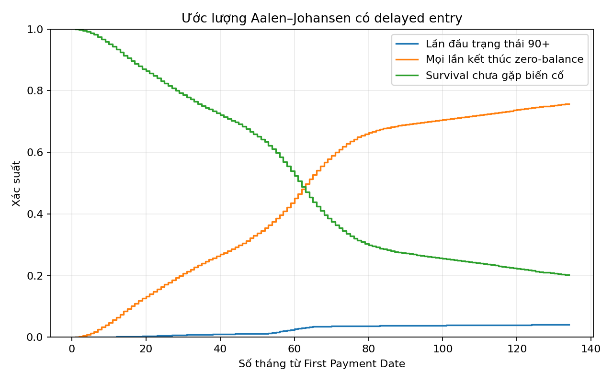
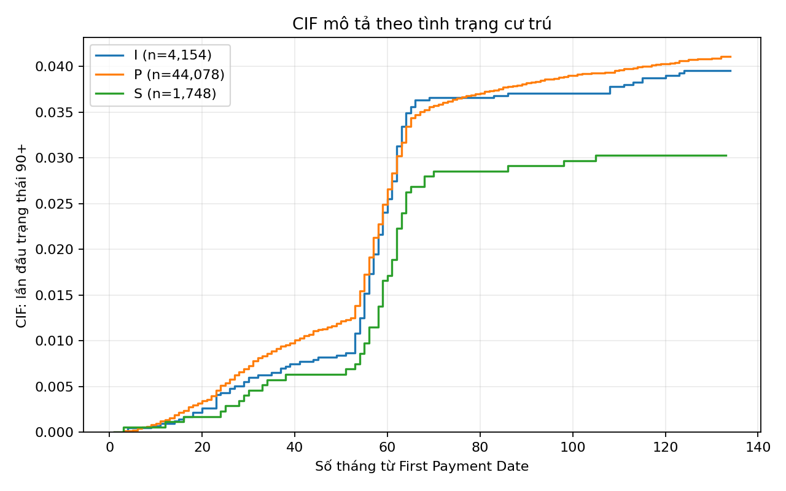

# Phân tích dữ liệu thăm dò

Cohort gồm 49,980 khoản vay. Nguyên nhân biến cố được mã hóa 0=kiểm duyệt phải, 1=lần đầu quá hạn 90+, và 2=kết thúc zero-balance.
Số lượng theo nguyên nhân: {'0': 10656, '1': 2019, '2': 37305}. Delayed entry áp dụng cho 2,736 khoản vay.
Số khoản vay bị loại vì ngày zero-balance effective date trước First Payment Date: 20.
Tháng performance đầu tiên so với First Payment Date: {'before': 43823, 'at': 3441, 'after': 2736}.
Trung vị thời gian theo dõi quan sát là 62 tháng; tối đa 134 tháng.
Chỉ chuyển mã đặc biệt thành thiếu dữ liệu ở các trường đã được tài liệu hóa. VantageScore 4.0 hoàn toàn không có trong cohort này.
Biểu đồ Kaplan–Meier coi các lần kết thúc cạnh tranh là kiểm duyệt và mô tả survival net theo nguyên nhân. Biểu đồ Aalen–Johansen ước lượng CIF quan sát bằng risk set delayed entry.
Các đường cong theo tình trạng cư trú mang tính mô tả, không hàm ý quan hệ nhân quả.

