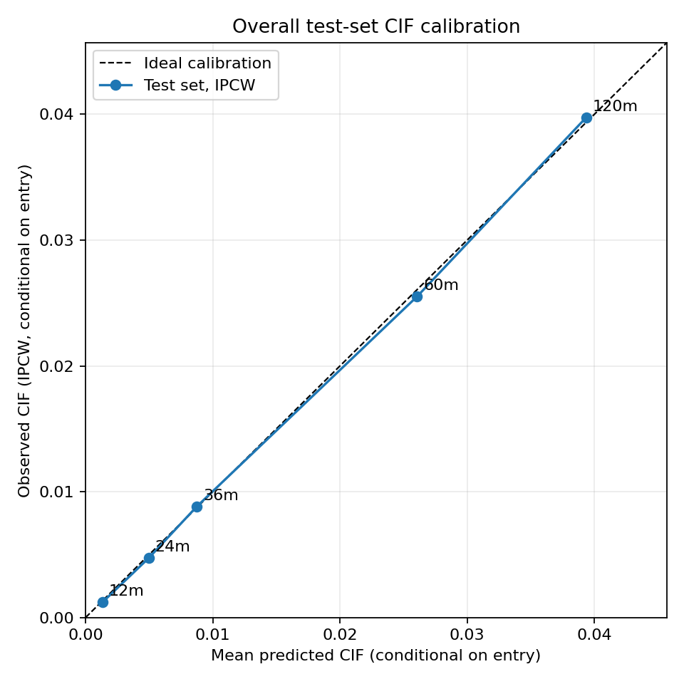

# Phân tích thời gian đến lần ghi nhận quá hạn 90+ đầu tiên

## Tóm tắt

Báo cáo áp dụng mô hình Cox nguyên nhân cụ thể và hàm incidence tích lũy (CIF) cho mẫu Freddie Mac SFLLD năm 2015. Biến cố chính là tháng đầu tiên hồ sơ ghi trạng thái quá hạn từ 90 ngày (`03+`), không phải định nghĩa pháp lý về vỡ nợ hay tổn thất tín dụng. Mọi kết thúc số dư bằng 0 được giữ mã gốc và gộp thành nguyên nhân cạnh tranh trong mô hình chính. Mẫu có 50.000 khoản vay: 2.019 biến cố chính, 37.325 kết thúc cạnh tranh và 10.656 bị kiểm duyệt phải. Trong kiểm tra 10.000 khoản vay, C-index có delayed entry là 0,752 (khoảng bootstrap 95%: 0,730–0,778). CIF dự báo tại 12, 24, 36 và 60 tháng gần với tỷ lệ IPCW quan sát tổng thể trong mẫu kiểm tra. Kết quả là liên hệ dự báo trong một vintage Freddie Mac, không phải tác động nhân quả hay bằng chứng khả năng khái quát sang vintage khác.

## 1. Câu hỏi nghiên cứu

Trong mẫu khoản vay Freddie Mac phát hành năm 2015, các đặc điểm tại thời điểm khởi tạo liên hệ như thế nào với thời điểm lần đầu xuất hiện trạng thái quá hạn 90+ ngày, khi tính đến việc khoản vay có thể kết thúc số dư trước đó? Cách đặt câu hỏi này giữ nguyên tính thời gian và các kết thúc cạnh tranh, thay vì gán mọi khoản vay kết thúc quan sát là vỡ nợ hoặc coi payoff là kiểm duyệt vô hại.

## 2. Dữ liệu và kiểm toán

Nguồn là Freddie Mac Single-Family Loan-Level Dataset Sample 2015, gồm tệp thông tin khởi tạo và lịch sử hiệu năng theo tháng. Có 50.000 mã khoản vay duy nhất khớp giữa hai tệp; 3.467.166 bản ghi performance, 35 trường mỗi dòng. Dữ liệu không có header, phân cách bằng `|`. Cửa sổ báo cáo chạy từ 201501 đến 202603. Kiểm toán phát hiện 0 bản ghi ID-tháng trùng; có hai khoảng trống lịch tháng ở hai khoản vay. Mọi chi tiết số trường, thiếu dữ liệu và mã được lưu ở [data audit](data_audit.md).

Thời gian bắt đầu tại First Payment Date theo tháng lịch. 2.736 khoản vay có delayed entry do lịch sử performance bắt đầu sau mốc này. Quan sát dùng khoảng cách tháng lịch; biến Loan Age chỉ được đối chiếu vì có thể thay đổi cách tính sau modification. Trường VantageScore 4.0 hoàn toàn thiếu trong vintage này. Chỉ biến khởi tạo được dùng làm dự báo, tránh rò rỉ thông tin sau thời điểm cho vay.

## 3. Định nghĩa kết quả

- **Nguyên nhân 1:** trạng thái quá hạn đầu tiên `03+`, tức ít nhất 90 ngày theo mã báo cáo tháng.
- **Nguyên nhân 2:** kết thúc số dư bằng 0 đầu tiên, giữ nguyên mã `01`, `02`, `03`, `09`, `15`, `16` hoặc `96` nếu xuất hiện.
- **Kiểm duyệt phải:** không quan sát hai nguyên nhân trên đến tháng cuối cùng trong dữ liệu.

Trong 37.325 kết thúc cạnh tranh, mã `01` chiếm 37.290, mã `96` có 30, mã `16` có 4 và mã `09` có 1. Mã `01` là payoff/tất toán trước hạn; do đó nhóm nguyên nhân cạnh tranh không nên được diễn giải chung thành “tất cả đều là trả trước”. Có 30 trường hợp ghi 90+ và zero-balance trong cùng tháng. Thứ tự trong tháng không xác định, nên phân tích chính xếp chúng vào nguyên nhân cạnh tranh; nếu xếp cả 30 vào biến cố chính, số event sẽ thành 2.049. Endpoint phụ mã `03` hoặc `09` chỉ có 73 trường hợp (18 mã `03`, 55 mã `09`), quá ít để fit Cox đa biến ổn định; chỉ báo cáo mô tả.

## 4. Phương pháp

Hai Cox nguyên nhân cụ thể được fit với delayed entry, một cho biến cố 90+ và một cho kết thúc zero-balance. Với mục tiêu ước tính CIF 90+, không dùng `1 − S_event` từ mô hình Cox đơn lẻ. Thay vào đó, mỗi mô hình cung cấp hazard theo tháng; các increment của hai nguyên nhân được tích phân cùng nhau với cập nhật competing exponential, giả định hazard từng nguyên nhân hằng trong mỗi tháng. Ước tính phi tham số tham chiếu là Aalen–Johansen theo tháng, sử dụng risk set có left truncation.

Đặc trưng gồm FICO, LTV, DTI, lãi suất, thời hạn, phần trăm bảo hiểm khoản vay, log dư nợ khởi tạo, tình trạng cư trú, mục đích vay, loại tài sản, first-time buyer, kênh, nhóm số người vay và số đơn vị. Giá trị sentinel được đổi thành missing theo định nghĩa trường; trung vị, scale và vocab phân loại được học từ tập huấn luyện. Mô hình nhạy cảm thay LTV bằng CLTV.

Chia ngẫu nhiên theo khoản vay 80/20, phân tầng theo event chính, seed 2026. Đây là holdout cùng vintage, không phải kiểm định theo thời gian. Đánh giá gồm Harrell C-index có delayed entry, Brier CIF/IPCW và hiệu chỉnh tổng thể tại các mốc 12, 24, 36, 60 tháng. Bootstrap 100 lần lấy mẫu lại khoản vay kiểm tra, giữ cố định mô hình, preprocessing và censoring model; khoảng này không bao gồm biến thiên do fit lại toàn bộ quy trình. Mô tả chi tiết ở [phương pháp](../docs/methodology.md).

## 5. Kết quả

### 5.1 Phân bố biến cố và CIF quan sát

Tập huấn luyện có 40.000 khoản vay (1.615 event chính, 29.867 kết thúc cạnh tranh, 8.518 kiểm duyệt); tập kiểm tra có 10.000 (404, 7.458, 2.138 tương ứng). CIF Aalen–Johansen toàn mẫu cho biến cố 90+ là 0,134% tại tháng 12, 0,496% tại tháng 24, 0,882% tại tháng 36, 2,617% tại tháng 60 và 3,983% tại tháng 120. Đây là xác suất quan sát tích lũy theo population risk set khi tính đến competing exits; không phải `1−KM` khi payoff bị kiểm duyệt.

| Tháng | Sống còn chưa gặp nguyên nhân nào | CIF 90+ | CIF zero-balance |
|---:|---:|---:|---:|
| 12 | 93,372% | 0,134% | 6,495% |
| 24 | 83,161% | 0,496% | 16,343% |
| 36 | 74,485% | 0,882% | 24,633% |
| 60 | 52,306% | 2,617% | 45,077% |
| 120 | 22,190% | 3,983% | 73,827% |

### 5.2 Khả năng xếp hạng và dự báo CIF

C-index trên holdout là **0,752**, với 2.297.088 cặp so sánh hợp lệ theo delayed entry. Khoảng percentile bootstrap 95% từ 100 mẫu test-loan là **0,730–0,778**. Đây là chỉ số phân biệt thứ hạng, không đánh giá trực tiếp độ chính xác xác suất.

| Mốc (tháng) | Brier IPCW | CIF dự báo trung bình | CIF quan sát IPCW | Khoản vay đủ điều kiện |
|---:|---:|---:|---:|---:|
| 12 | 0,00123 | 0,00135 | 0,00124 | 9.709 |
| 24 | 0,00468 | 0,00498 | 0,00473 | 9.725 |
| 36 | 0,00865 | 0,00879 | 0,00883 | 9.741 |
| 60 | 0,02424 | 0,02661 | 0,02550 | 10.000 |

Trong các mốc này, ước lượng censor-survival tại horizon bằng 1; do vậy hiệu chỉnh IPCW tương đương tỷ lệ quan sát cho các đối tượng đã biết trạng thái. Brier score tăng theo horizon, phù hợp với xác suất tích lũy và mức độ bất định tăng theo thời gian. Các kết quả calibration là có điều kiện theo đã vào risk set trước horizon và được tính trên test set.

Kiểm tra độ nhạy thay LTV bằng CLTV cho C-index **0,7524**, nhỉnh hơn mô hình chính khoảng 0,0009. Chênh lệch nhỏ và không được xem là bằng chứng CLTV có ưu thế tổng quát; hai mô hình dùng cùng cách chia train/test.

### 5.3 Liên hệ của đặc trưng khởi tạo

Các HR sau áp dụng cho một đơn vị scale của biến liên tục đã chuẩn hóa trong tập train; chúng là liên hệ có điều kiện trên các biến trong mô hình. FICO cao hơn liên hệ với hazard nguyên nhân 90+ thấp hơn (HR 0,612; KTC 95% 0,584–0,641). LTV (HR 1,181; 1,111–1,255), DTI (HR 1,288; 1,213–1,367) và lãi suất (HR 1,305; 1,213–1,404) liên hệ với hazard cao hơn. Không diễn giải các HR này thành tác động nhân quả; thay đổi về PH, đặc tả mô hình và chọn mẫu có thể ảnh hưởng kết quả.

### 5.4 Chẩn đoán

Xu hướng tương quan phần dư Schoenfeld xấp xỉ gợi ý khả năng vi phạm PH ở một số biến: FICO, lãi suất, DTI-missing, log dư nợ, loại tài sản và LTV có tín hiệu sau hiệu chỉnh BH trong chẩn đoán tùy chỉnh. Chẩn đoán này không phải residual test đã chuẩn hóa; công cụ chuẩn hóa sẵn không hỗ trợ entry-column của fit hiện tại. Vì vậy, giả định PH chưa được xác nhận hoàn toàn, và diễn giải hazard ratio là trung bình theo thời gian có điều kiện theo mô hình. Bảng đầy đủ ở `reports/tables/schoenfeld_trend_approx.csv`.

## 6. Thảo luận và giới hạn

Số event chính thấp so với số kết thúc zero-balance; payoff cạnh tranh làm giảm số khoản vay còn trong risk set quan sát cho event 90+. Cách dùng cause-specific hazards kết hợp CIF giải quyết việc phân biệt hazard nguyên nhân với xác suất tích lũy khi tồn tại competing risks. Mặt khác, hiệu quả ranking khá hơn ngẫu nhiên không chứng minh mô hình đã được hiệu chỉnh hoặc chuyển giao tốt ở các vintage khác.

Các giới hạn chính: mẫu chỉ gồm vintage 2015 và là sample Freddie Mac; định nghĩa 90+ là proxy dựa trên báo cáo tháng; event ordering cùng tháng không biết; zero-balance effective date thiếu được thay bằng report month cho một số khoản vay; censoring có thể phụ thuộc yếu tố chưa mô hình hóa; PH có dấu hiệu cần xem xét; và bootstrap chỉ điều kiện trên mô hình đã fit. Cần external/time validation và phân tích độ nhạy bổ sung trước mọi ứng dụng vận hành. Endpoint B chưa đủ event để mô hình đa biến đáng tin cậy.

## 7. Khả năng tái lập và tệp đầu ra

Chạy `python src/survival_pipeline.py --bootstrap 100`, `python src/eda.py` và `python -m unittest discover -s tests -v`. Bảng survival một dòng mỗi khoản vay ở `outputs/survival_dataset.csv`; model bundle kèm preprocessing ở `outputs/models/cause_specific_cox_models.pkl`; metrics, CIF, calibration, bootstrap và hệ số ở `outputs/models/` và `reports/tables/`. Hàm `score_new_loans()` có thể áp dụng model bundle cho các dòng khởi tạo mới có cùng schema; dự báo có điều kiện loan sống đến delayed entry.

## Tài liệu tham khảo

- Freddie Mac, [Single-Family Loan-Level Dataset](https://www.freddiemac.com/research/datasets/sf-loanlevel-dataset), [General User Guide, July 2026](https://www.freddiemac.com/fmac-resources/research/pdf/general_user_guide_july_2026.pdf), và [Release 47 disclosure changes](https://www.freddiemac.com/fmac-resources/research/pdf/disclosure-changes-summary.pdf).
- Cox, D. R. (1972). Regression Models and Life-Tables. *Journal of the Royal Statistical Society: Series B*, 34(2), 187–220. [doi](https://rss.onlinelibrary.wiley.com/doi/10.1111/j.2517-6161.1972.tb00899.x).
- Aalen, O. O. & Johansen, S. (1978). An empirical transition matrix for non-homogeneous Markov chains based on censored observations. *Scandinavian Journal of Statistics*, 5(3), 141–150. [paper](https://gwern.net/doc/statistics/survival-analysis/1978-aalen.pdf).
