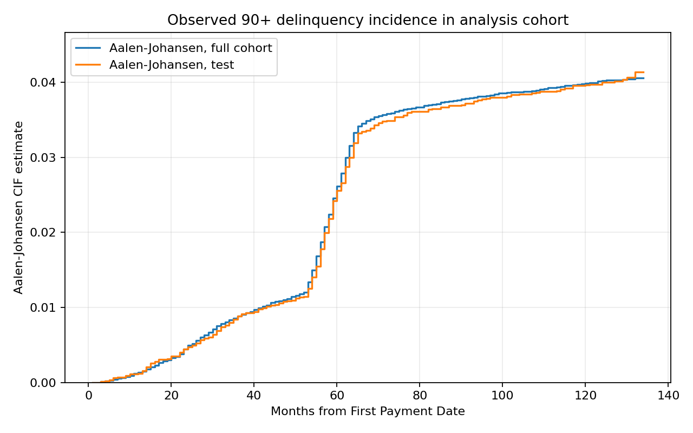

# Phân tích thời gian đến lần ghi nhận quá hạn 90+ đầu tiên

## Tóm tắt

Báo cáo áp dụng mô hình Cox nguyên nhân cụ thể và hàm incidence tích lũy (CIF) cho mẫu Freddie Mac SFLLD năm 2015. Biến cố chính là tháng đầu tiên hồ sơ ghi trạng thái quá hạn từ 90 ngày (`03+`), không phải định nghĩa pháp lý về vỡ nợ hay tổn thất tín dụng. Mẫu phân tích có 49.980 khoản vay: 2.019 biến cố chính, 37.305 kết thúc cạnh tranh và 10.656 bị kiểm duyệt phải. Hai mươi khoản vay có zero-balance effective date trước First Payment Date được loại vì kết thúc xảy ra trước time origin. Trong holdout ngẫu nhiên 9.996 khoản vay, C-index có delayed entry là 0,751 (khoảng bootstrap 95%: 0,733–0,774). Một holdout theo FPD muộn hơn trong cùng mẫu có C-index 0,751 trên 1.849.210 cặp so sánh. Đây là liên hệ dự báo trong một mẫu Freddie Mac, không phải tác động nhân quả, validation bên ngoài hay bằng chứng khái quát sang vintage khác.

## 1. Câu hỏi nghiên cứu

Trong mẫu khoản vay Freddie Mac phát hành năm 2015, các đặc điểm tại thời điểm khởi tạo liên hệ như thế nào với thời điểm lần đầu xuất hiện trạng thái quá hạn 90+ ngày, khi tính đến việc khoản vay có thể kết thúc số dư trước đó? Cách đặt câu hỏi này giữ nguyên tính thời gian và các kết thúc cạnh tranh, thay vì gán mọi khoản vay kết thúc quan sát là vỡ nợ hoặc coi payoff là kiểm duyệt vô hại.

## 2. Dữ liệu và kiểm toán

Nguồn là Freddie Mac Single-Family Loan-Level Dataset Sample 2015, gồm tệp thông tin khởi tạo và lịch sử hiệu năng theo tháng. Có 50.000 mã khoản vay duy nhất khớp giữa hai tệp; 3.467.166 bản ghi performance, 35 trường mỗi dòng. Dữ liệu không có header, phân cách bằng `|`. Cửa sổ báo cáo chạy từ 201501 đến 202603. Kiểm toán phát hiện 0 bản ghi ID-tháng trùng; có hai khoảng trống lịch tháng ở hai khoản vay. First performance month của 43.823 khoản vay trước, 3.441 khoản bằng, và 2.736 khoản sau First Payment Date; khoản đầu được coi là đã có lịch sử vào time origin, khoản cuối có delayed entry. Mọi chi tiết số trường, thiếu dữ liệu và mã được lưu ở [data audit](data_audit.md).

Thời gian bắt đầu tại First Payment Date theo tháng lịch. 2.736 khoản vay có delayed entry do lịch sử performance bắt đầu sau mốc này. Quan sát dùng khoảng cách tháng lịch; biến Loan Age chỉ được đối chiếu vì có thể thay đổi cách tính sau modification. Trường VantageScore 4.0 hoàn toàn thiếu trong vintage này. Chỉ biến khởi tạo được dùng làm dự báo, tránh rò rỉ thông tin sau thời điểm cho vay.

## 3. Định nghĩa kết quả

- **Nguyên nhân 1:** trạng thái quá hạn đầu tiên `03+`, tức ít nhất 90 ngày theo mã báo cáo tháng.
- **Nguyên nhân 2:** kết thúc số dư bằng 0 đầu tiên, giữ nguyên mã `01`, `02`, `03`, `09`, `15`, `16` hoặc `96` nếu xuất hiện.
- **Kiểm duyệt phải:** không quan sát hai nguyên nhân trên đến tháng cuối cùng trong dữ liệu.

Trong 37.305 kết thúc cạnh tranh, mã `01` chiếm 37.271, mã `96` có 29, mã `16` có 4 và mã `09` có 1. Mã `01` là payoff/tất toán trước hạn; do đó nhóm nguyên nhân cạnh tranh không nên được diễn giải chung thành “tất cả đều là trả trước”. Có 30 trường hợp ghi 90+ và zero-balance trong cùng tháng. Thứ tự trong tháng không xác định, nên phân tích chính xếp chúng vào nguyên nhân cạnh tranh; nếu xếp cả 30 vào biến cố chính, số event sẽ thành 2.049. Endpoint phụ mã `03` hoặc `09` chỉ có 73 trường hợp (18 mã `03`, 55 mã `09`), quá ít để fit Cox đa biến ổn định; chỉ báo cáo mô tả.

## 4. Phương pháp

Hai Cox nguyên nhân cụ thể được fit với delayed entry, một cho biến cố 90+ và một cho kết thúc zero-balance. Với mục tiêu ước tính CIF 90+, không dùng `1 − S_event` từ mô hình Cox đơn lẻ. Tại endpoint tháng \(t\), code lấy cumulative-hazard increment giữa hai ranh giới kế tiếp:
\[
\Delta H_{k,t}(x)=H_k(t\mid x)-H_k(t-1\mid x)=\int_{t-1}^{t}\lambda_k(u\mid x)\,du.
\]
Đây là integrated hazard của cause \(k\) trong khoảng \((t-1,t]\), không phải xác suất event tháng đó. Để tính CIF dự báo, pipeline nội suy increment này thành cause-specific hazard hằng trong từng tháng. Khi đó survival nhân với `exp(−ΣΔH)`, và CIF của mỗi cause nhận phần tương ứng \((1-\exp(-\Delta H_{\cdot,t}))\Delta H_{k,t}/\Delta H_{\cdot,t}\); nếu tổng increment bằng 0 thì CIF không tăng. Cập nhật competing-exponential là chính xác có điều kiện trên phép nội suy hazard hằng này, nhưng dữ liệu tháng không xác nhận hazard thực tế hằng trong tháng. Đây là CIF do Cox suy ra theo quy ước nội suy, không phải cập nhật Aalen–Johansen rời rạc từ tỷ lệ event/risk set. Hai cách có thể cho kết quả khác nhau. Với delayed entry \(e\), khởi tạo survival bằng 1 và CIF bằng 0 tại \(e\), rồi tích lũy chỉ trên interval \(t>e\); dự báo đến horizon là xác suất có điều kiện khoản vay event-free qua entry, không phải xác suất vô điều kiện tính từ FPD. Ước tính phi tham số tham chiếu là Aalen–Johansen theo tháng với delayed-entry risk sets.

Đặc trưng gồm FICO, LTV, DTI, lãi suất, thời hạn, phần trăm bảo hiểm khoản vay, log dư nợ khởi tạo, tình trạng cư trú, mục đích vay, loại tài sản, first-time buyer, kênh, nhóm số người vay và số đơn vị. Giá trị sentinel được đổi thành missing theo định nghĩa trường; trung vị, scale và vocab phân loại được học từ tập huấn luyện. Mô hình nhạy cảm thay LTV bằng CLTV.

Chia ngẫu nhiên theo khoản vay 80/20, phân tầng theo event chính, seed 2026. Đây là holdout cùng vintage, không phải kiểm định theo thời gian. Bổ sung một holdout cohort outcome-blind theo First Payment Date: train đến 201512, test sau 201512. Cả hai đánh giá tại 12, 24, 36, 60 và 120 tháng. C-index đo khả năng phân biệt thứ hạng; Brier là sai số bình phương của xác suất dự báo; calibration summaries so sánh tỷ lệ dự báo và quan sát, không thay thế Brier. Bootstrap 100 lần lấy mẫu lại khoản vay test, giữ cố định fitted models, predictions, preprocessing và censoring model; khoảng này không bao gồm bất định do fit lại, split hay cohort. Mô tả chi tiết ở [phương pháp](../docs/methodology.md).

## 5. Kết quả

### 5.1 Phân bố biến cố và CIF quan sát

Tập huấn luyện có 39.984 khoản vay (1.615 event chính, 29.845 kết thúc cạnh tranh, 8.524 kiểm duyệt); tập kiểm tra có 9.996 (404, 7.460, 2.132 tương ứng). Ước tính CIF Aalen–Johansen của toàn cohort phân tích cho biến cố 90+ là 0,134% tại tháng 12, 0,496% tại tháng 24, 0,882% tại tháng 36, 2,618% tại tháng 60 và 3,985% tại tháng 120. Đây là estimate từ risk sets quan sát có tính competing exits; diễn giải thành xác suất của population cần giả định phù hợp về independent entry/left truncation và right censoring, chưa được xác minh ở đây. Không phải `1−KM` với payoff bị kiểm duyệt.

| Tháng | Sống còn chưa gặp nguyên nhân nào | CIF 90+ | CIF zero-balance |
|---:|---:|---:|---:|
| 12 | 93,411% | 0,134% | 6,455% |
| 24 | 83,196% | 0,496% | 16,308% |
| 36 | 74,517% | 0,882% | 24,601% |
| 60 | 52,328% | 2,618% | 45,054% |
| 120 | 22,199% | 3,985% | 73,816% |

### 5.2 Khả năng xếp hạng và dự báo CIF

C-index trên holdout ngẫu nhiên là **0,751**, với **2.277.701 cặp so sánh** hợp lệ theo delayed entry. Khoảng percentile bootstrap 95% từ 100 mẫu test-loan là **0,733–0,774**. Đây là chỉ số discrimination, không đánh giá trực tiếp độ chính xác xác suất.

| Mốc (tháng) | Brier IPCW* | Brier Cox, trạng thái đã biết | Eligible / known-status N | CIF dự báo trung bình | CIF quan sát IPCW |
|---:|---:|---:|---:|---:|---:|
| 12 | 0,001234 | 0,001234 | 9.712 / 9.712 | 0,001324 | 0,001236 |
| 24 | 0,004672 | 0,004672 | 9.727 / 9.727 | 0,004892 | 0,004729 |
| 36 | 0,008640 | 0,008640 | 9.741 / 9.741 | 0,008630 | 0,008829 |
| 60 | 0,024186 | 0,024186 | 9.996 / 9.996 | 0,026151 | 0,025510 |
| 120 | 0,037024 | 0,037052 | 9.996 / 9.988 | 0,039624 | 0,039737 |

Hai cột Brier là hai đại lượng khác nhau. Brier IPCW dùng mẫu số là toàn bộ khoản test eligible theo entry (`entry < horizon`), với loss được nhân trọng số inverse-censoring; censor trước horizon đóng góp loss 0 theo công thức ước lượng. Brier trạng thái đã biết là trung bình loss không trọng số chỉ trên khoản eligible có trạng thái tại horizon quan sát được; censor trước horizon bị loại khỏi mẫu số. Vì vậy, tại 120 tháng, IPCW có 9.996 eligible còn Brier known-status có 9.988 known outcomes. Cả hai là sai số bình phương xác suất trên các tập/giả định khác nhau, không thể thay thế cho nhau.

Tại 12–60 tháng, reverse-KM censor survival trước horizon bằng 1; tại 120 tháng là 0,998746, max IPCW 1,00126 và effective sample size khoảng 9.988. Có 8 khoản test bị censor trước 120 tháng. Calibration summaries so sánh mean prediction trên toàn bộ eligible với tỷ lệ outcome quan sát có trọng số IPCW; đây là các điểm ước lượng mô tả calibration-in-the-large, không phải Brier và không có khoảng tin cậy. Censoring trong dữ liệu là administrative tại cutoff chung 202603, nên follow-up tiềm năng phụ thuộc tất định vào First Payment Date/lịch bắt đầu. Marginal reverse-KM đòi hỏi censoring phù hợp với giả định độc lập có điều kiện theo cấu trúc entry; giả định đó không được dữ liệu xác nhận. Trọng số gần 1 chỉ phản ánh fitted reverse-KM và không chứng minh giả định đúng. Do đó không diễn giải IPCW là ước lượng không chệch cho hiệu năng toàn cohort.

Để có đối chiếu không ước lượng (G), báo cáo thêm Brier trên các khoản test có trạng thái horizon đã biết và benchmark CIF Aalen–Johansen chỉ fit trên training, điều kiện hóa theo việc event-free tại entry. Censor trước horizon bị loại khỏi cả hai điểm; tại 120 tháng còn 9.988 loan. Chênh lệch là Cox trừ benchmark; khoảng bootstrap ghép cặp 95% lấy mẫu lại test loans, giữ hai đường cong dự báo cố định.

| Tháng | Brier Cox trên trạng thái đã biết | Brier train-AJ reference | Chênh lệch Cox − AJ (95% paired bootstrap CI) | N đã biết |
|---:|---:|---:|---:|---:|
| 12 | 0,001234 | 0,001234 | −0,0000005 (−0,0000041; 0,0000021) | 9.712 |
| 24 | 0,004672 | 0,004707 | −0,0000348 (−0,0000719; −0,0000125) | 9.727 |
| 36 | 0,008640 | 0,008751 | −0,0001104 (−0,0001693; −0,0000516) | 9.741 |
| 60 | 0,024186 | 0,024857 | −0,0006709 (−0,0009190; −0,0003726) | 9.996 |
| 120 | 0,037052 | 0,038171 | −0,0011188 (−0,0015840; −0,0007055) | 9.988 |

Trong split ngẫu nhiên cùng vintage này, điểm Cox thấp hơn benchmark ở 24–120 tháng; tại 12 tháng chênh lệch không phân biệt được 0 theo bootstrap. Đây là so sánh dự báo test có điều kiện trên đường cong AJ training đã fit, không bao gồm bất định do training, lựa chọn mô hình hay split. Ở 120 tháng, trạng thái được biết cho các loan đã có một trong hai biến cố trước đó hoặc còn được quan sát đến tháng 120; 8 khoản censor trước horizon bị loại. Vì vậy đây là score trên tập có outcome quan sát được, không phải chứng minh hiệu năng trên toàn bộ cohort hay khả năng khái quát qua vintage.

Kiểm tra độ nhạy thay LTV bằng CLTV cho C-index **0,75249**, cao hơn mô hình chính 0,00130; hai mô hình dùng cùng cách chia train/test. Khi gán cả 30 tie cùng tháng cho event 90+ và giữ nguyên chính xác cùng train/test IDs, C-index là **0,75353** (test events tăng 404→410; competing exits giảm 7.460→7.454). Brier tăng từ 0,004672 lên 0,004771 ở 24 tháng, 0,008640 lên 0,009132 ở 36 tháng, 0,024186 lên 0,024721 ở 60 tháng và 0,037024 lên 0,037526 ở 120 tháng. Chênh lệch nhỏ về event coding làm đổi xác suất/metrics như dự kiến; phân tích chính vẫn dùng quy tắc termination là competing vì thứ tự trong tháng không biết.

### 5.3 Holdout cohort theo thời điểm bắt đầu

Phân chia outcome-blind theo FPD: huấn luyện trên FPD đến 201512 và kiểm tra trên FPD sau 201512. Tập train có 41.908 khoản vay (1.642 event 90+, 31.377 competing exits, 8.889 censored); tập test có 8.072 khoản (377 event 90+, 5.928 competing exits, 1.767 censored). C-index test là **0,751**, với **1.849.210 cặp so sánh** hợp lệ theo delayed entry; khoảng bootstrap test-loan 95% là 0,735–0,770. C-index là discrimination, không phải calibration hoặc accuracy xác suất.

| Tháng | Brier IPCW* | Brier Cox, trạng thái đã biết | Brier train-AJ | Cox − AJ (95% paired CI) | Known / eligible |
|---:|---:|---:|---:|---:|---:|
| 12 | 0,002005 | 0,002005 | 0,002012 | −0,00000660 (−0,00001118; −0,00000160) | 7.940 / 7.940 |
| 24 | 0,009794 | 0,009794 | 0,009863 | −0,00006838 (−0,00009868; −0,00003983) | 7.959 / 7.959 |
| 36 | 0,011853 | 0,011853 | 0,012014 | −0,00016165 (−0,00022986; −0,00008855) | 7.986 / 7.986 |
| 60 | 0,038078 | 0,038078 | 0,039161 | −0,00108297 (−0,00134899; −0,00079157) | 8.072 / 8.072 |
| 120 | 0,042958 | 0,043065 | 0,044469 | −0,00140362 (−0,00184130; −0,00108221) | 8.052 / 8.072 |

\*IPCW Brier chịu các giả định censoring đã nêu ở trên. Ở tháng 120, 20 khoản test bị censor trước horizon (8.052/8.072 status đã biết), nhưng reverse-KM huấn luyện cho \(G(120^-) = 1\) và trọng số lớn nhất là 1; điều này phản ánh support trong training censoring fit, không xác minh independent censoring cho các khoản test muộn. Cả IPCW và known-status Brier đều thấp hơn train-AJ ở 5 horizon trên holdout này; paired intervals giữ prediction Cox và AJ cố định, không bao gồm bất định fit hay cohort. Calibration summaries (nếu diễn giải cùng các bảng/đồ thị calibration) là point estimates không có intervals. Kết quả theo thời điểm này chỉ là **validation nội bộ theo cohort muộn trong cùng sample**: 8.060/8.072 khoản test có FPD năm 2016 và chỉ 12 khoản bắt đầu từ 2017 trở đi. Kết quả train năm 2015 được quan sát đến cutoff dữ liệu 2026, nên đây không phải mô phỏng phát triển mô hình tại một thời điểm lịch sử rồi dự báo tương lai. Đây cũng không phải external validation.

### 5.4 Liên hệ của đặc trưng khởi tạo

Các HR sau áp dụng cho một đơn vị scale của biến liên tục đã chuẩn hóa trong tập train; chúng là liên hệ có điều kiện trên các biến trong mô hình. FICO cao hơn liên hệ với hazard nguyên nhân 90+ thấp hơn (HR 0,614; KTC 95% 0,586–0,643). LTV (HR 1,185; 1,115–1,260), DTI (HR 1,292; 1,217–1,372) và lãi suất (HR 1,311; 1,218–1,411) liên hệ với hazard cao hơn. Không diễn giải các HR này thành tác động nhân quả; thay đổi về PH, đặc tả mô hình và chọn mẫu có thể ảnh hưởng kết quả.

### 5.5 Chẩn đoán

Xu hướng tương quan phần dư Schoenfeld xấp xỉ gợi ý khả năng vi phạm PH ở một số biến: FICO, lãi suất, DTI-missing, log dư nợ, loại tài sản và LTV có tín hiệu sau hiệu chỉnh BH trong chẩn đoán tùy chỉnh. Chẩn đoán này không phải residual test đã chuẩn hóa; công cụ chuẩn hóa sẵn không hỗ trợ entry-column của fit hiện tại. Vì vậy, giả định PH chưa được xác nhận hoàn toàn, và diễn giải hazard ratio là trung bình theo thời gian có điều kiện theo mô hình. Bảng đầy đủ ở `reports/tables/schoenfeld_trend_approx.csv`.

## 6. Thảo luận và giới hạn

Số event chính thấp so với số kết thúc zero-balance; payoff cạnh tranh làm giảm số khoản vay còn trong risk set quan sát cho event 90+. Cách dùng cause-specific hazards kết hợp CIF giải quyết việc phân biệt hazard nguyên nhân với xác suất tích lũy khi tồn tại competing risks. Mặt khác, hiệu quả ranking khá hơn ngẫu nhiên không chứng minh mô hình đã được hiệu chỉnh hoặc chuyển giao tốt ở các vintage khác.

Các giới hạn chính: mẫu chỉ gồm vintage 2015 và là sample Freddie Mac; đường AJ là cohort estimate, còn diễn giải population cần independent truncation và right-censoring; định nghĩa 90+ là proxy dựa trên báo cáo tháng; event ordering cùng tháng không biết; giả định left truncation phù hợp và không có biến cố chưa quan sát trước first performance chưa được kiểm chứng; CIF Cox phụ thuộc xấp xỉ nội suy hazard hằng trong tháng; delayed-entry predictions là conditional từ entry; censoring administrative phụ thuộc lịch FPD nên giả định marginal IPCW không được xác nhận; PH có dấu hiệu cần xem xét; calibration summaries là point estimates; và bootstrap 100 lần chỉ điều kiện trên mô hình/predictions đã fit, không bao gồm bất định do model fitting, split hay cohort. Hai tháng bị thiếu trong hai loan histories khiến thời điểm event tại các khoảng đó chỉ xác định ở mức tháng báo cáo kế tiếp. Holdout FPD muộn là kiểm định nội bộ trong cùng sample, không thay cho external validation. Endpoint B chưa đủ event để mô hình đa biến đáng tin cậy.

## 7. Khả năng tái lập và tệp đầu ra

Chạy `python src/survival_pipeline.py --bootstrap 100`, `python src/eda.py` và `python -m unittest discover -s tests -v`. Bảng survival một dòng mỗi khoản vay ở `outputs/survival_dataset.csv`; model bundle kèm preprocessing ở `outputs/models/cause_specific_cox_models.pkl`; metrics, CIF, calibration, bootstrap và hệ số ở `outputs/models/` và `reports/tables/`. Hàm `score_new_loans()` có thể áp dụng model bundle cho các dòng khởi tạo mới có cùng schema; dự báo có điều kiện loan sống đến delayed entry.

## Tài liệu tham khảo

- Freddie Mac. (2026). *Single-Family Loan-Level Dataset* ([dataset page](https://www.freddiemac.com/research/datasets/sf-loanlevel-dataset)); *General User Guide* (July 2026; [PDF](https://www.freddiemac.com/fmac-resources/research/pdf/general_user_guide_july_2026.pdf)); *Release 47 disclosure changes* ([PDF](https://www.freddiemac.com/fmac-resources/research/pdf/disclosure-changes-summary.pdf)).
- Cox, D. R. (1972). Regression Models and Life-Tables. *Journal of the Royal Statistical Society: Series B (Methodological)*, 34(2), 187–202. [doi](https://doi.org/10.1111/j.2517-6161.1972.tb00899.x).
- Aalen, O. O., & Johansen, S. (1978). An empirical transition matrix for non-homogeneous Markov chains based on censored observations. *Scandinavian Journal of Statistics*, 5(3), 141–150. [JSTOR](https://www.jstor.org/stable/4615704).
